<p align="center">
  
</p>

<h1 align="center">Boost My Pc</h1>

<p align="center"><b>Clean, protect, and speed up your PC — on Linux and Windows.</b></p>

Boost My Pc 2 brings together more than 25 PC maintenance tools, with a distinct color for each module. Its features take inspiration from **CleanMyMac** and **Microsoft PC Manager**. This is an independent project: it reuses no logos, icons, or code from those applications. The interface is available in **French, English, and Malagasy**.

<p align="center">
  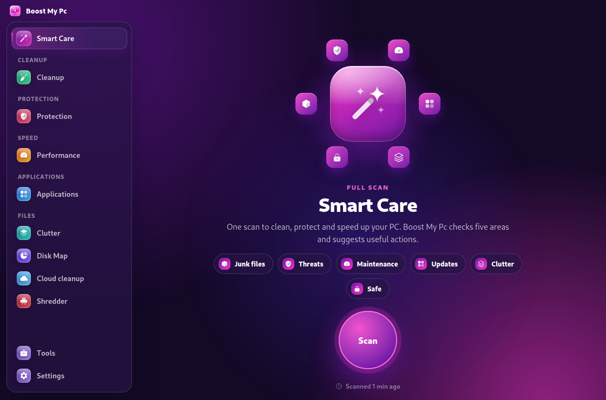
</p>

## Screenshots (Linux)

### Smart Care

One scan checks five areas; one click applies safe actions.


| Cleanup | Protection overview |
|---|---|
|  | 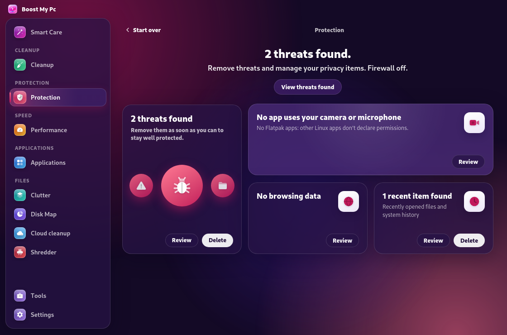 |

| Privacy | Performance overview |
|---|---|
| 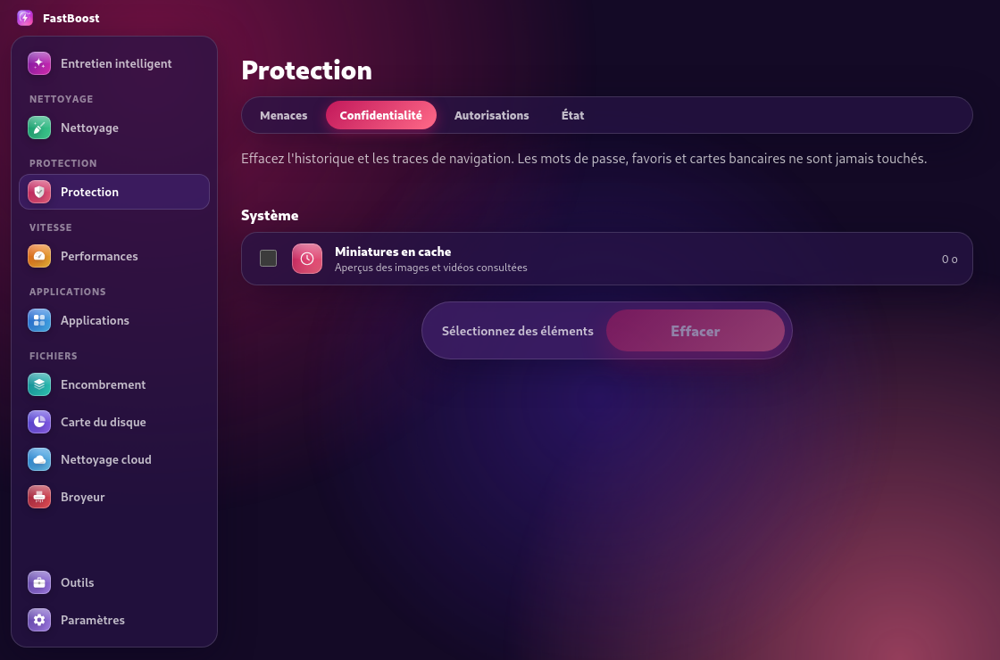 | 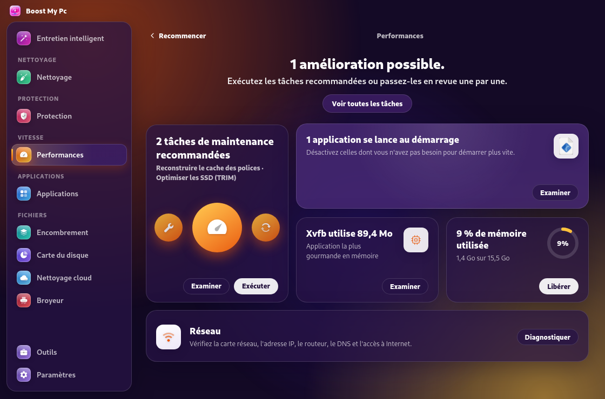 |

| App leftovers | Similar images |
|---|---|
| 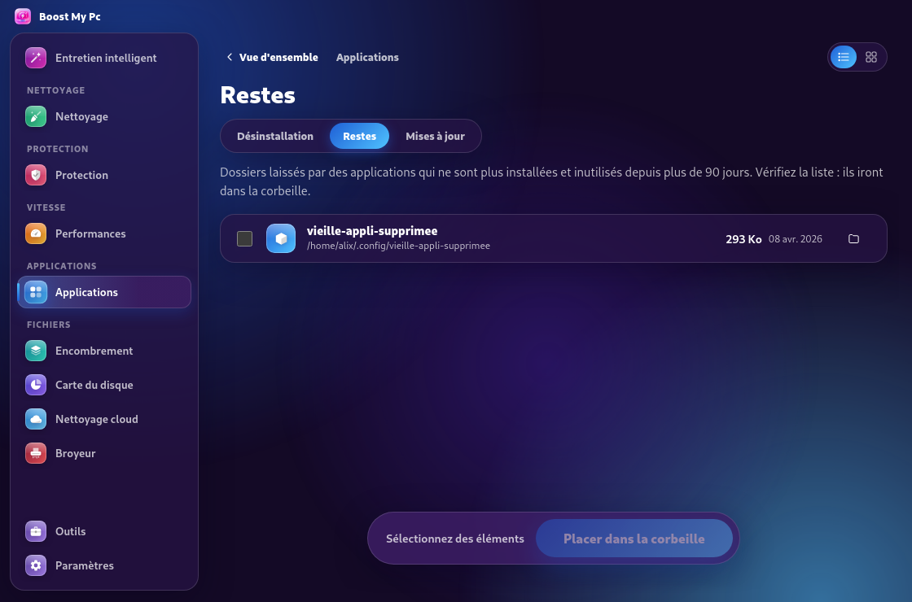 | 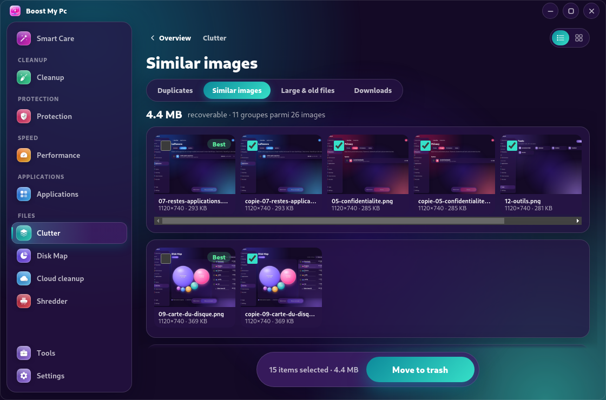 |

| Disk Map | Cloud Cleanup |
|---|---|
| 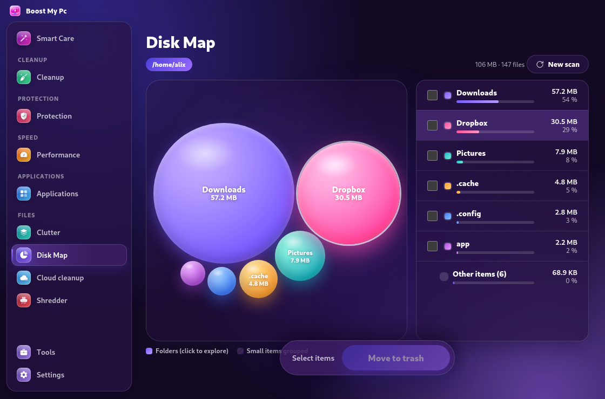 | 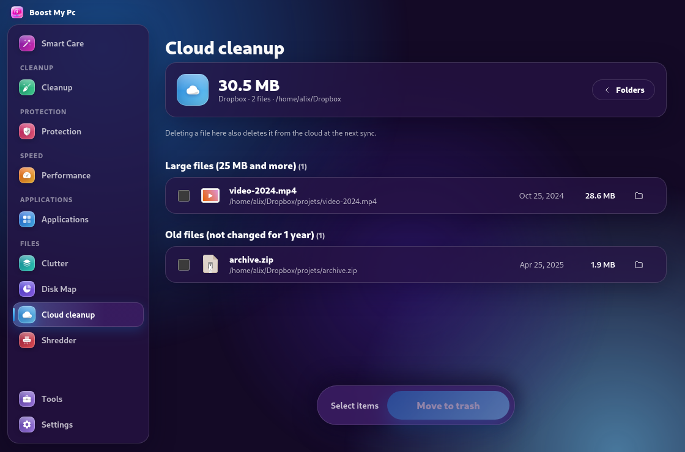 |

| Shredder | Tools | PC health (Settings) |
|---|---|---|
| 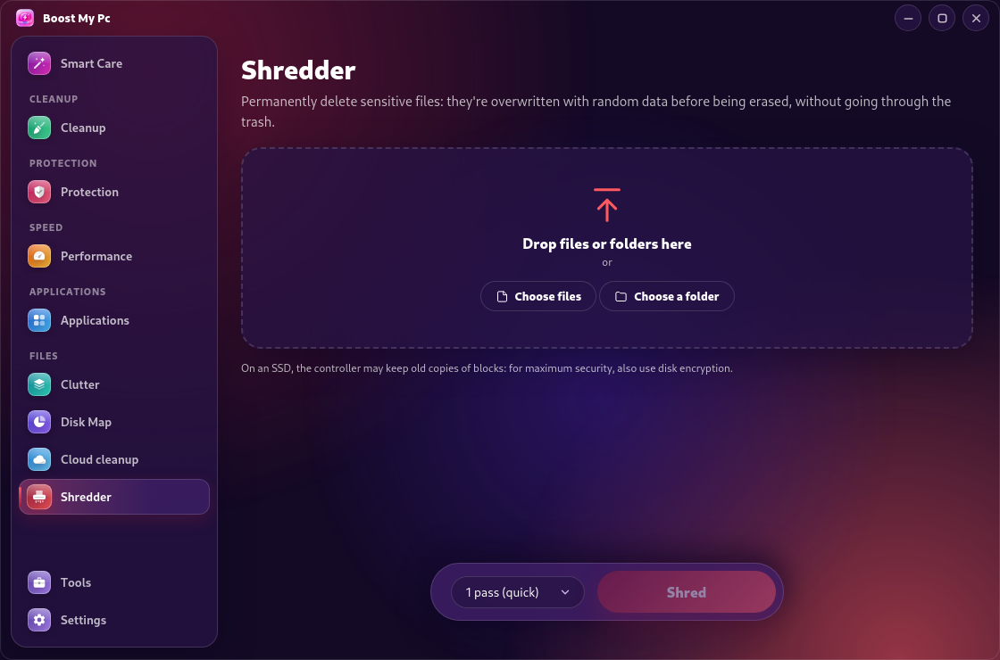 | 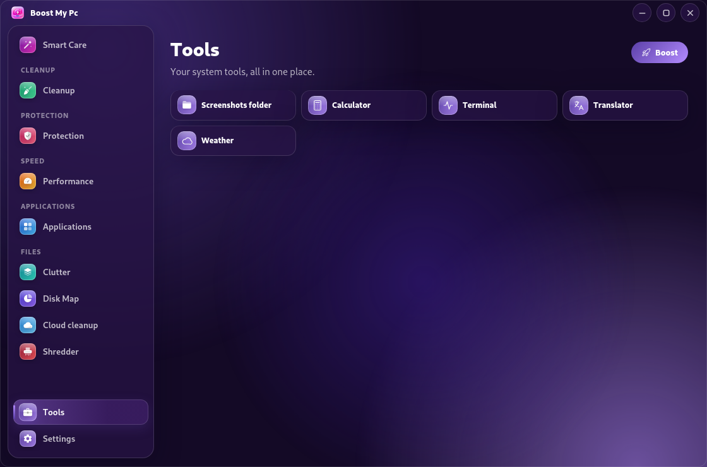 | 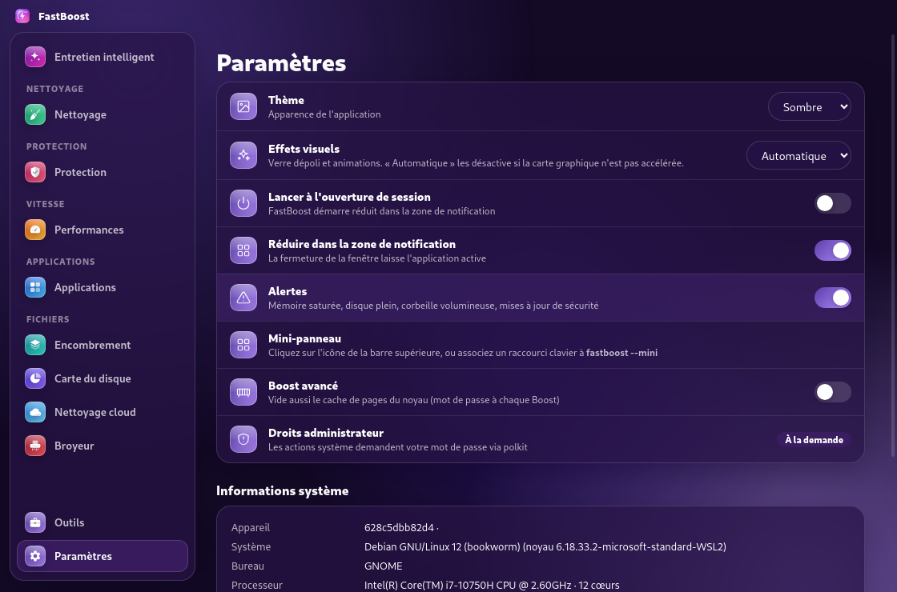 |

> Screenshots were captured on Debian 12 (Xvfb) with test data and the English interface; the desktop panel and window controls are not shown. They show the current version; regenerate them with `scripts/docker-v2.sh` (`scripts/readme-shots.sh` names them `readme-01` to `readme-13`).

## Modules

| Module | What it does |
|---|---|
| **Smart Care** | Checks for junk files, threats, maintenance tasks, updates, and large forgotten files in one scan. Results appear as tiles around a round button that shows progress; **Run** applies safe actions, and **Stop** ends the scan. |
| **Cleanup** | Cleans system and browser caches, temporary files, logs, crash reports, package caches, development caches (npm, pip, Yarn, Gradle, Cargo), and the trash. |
| **Protection** | Runs quick, standard, or deep scans (ClamAV with heuristic scanning on Linux; Microsoft Defender on Windows); manages privacy data (history, cookies, sessions — never passwords or bookmarks); checks app permissions and lets you remove them (Flatpak on Linux; camera, microphone and location on Windows); shows firewall and antivirus status and turns them back on when they are off. |
| **Performance** | Diagnoses and fixes system problems (Windows: essential services, disk errors, firewall, Defender, DNS, clock, system files with DISM/SFC; Linux: failed services, broken packages, journal size, clock, DNS) with one authorization for all fixes. Runs maintenance tasks (DNS, fonts, SSD TRIM, logs, orphaned packages, and more), manages startup apps, finds resource-heavy processes, and diagnoses network issues. |
| **Applications** | Uninstalls apps (apt, dnf, pacman, zypper, Flatpak, Snap on Linux; Windows apps and Microsoft Store apps), finds leftovers from removed apps, and checks for updates, including **driver updates** from official sources only (Windows Update on Windows, fwupd/LVFS on Linux) with the current and new version of each driver and per-driver install progress. |
| **Storage** | Finds exact duplicates, similar images (perceptual hash), large and old files, and downloads. |
| **Disk Map** | Shows folders and files as bubbles sized by disk usage. Click a folder to zoom in, and remove items you no longer need. The scan runs in a separate process, so a slow or unresponsive folder can't block it. |
| **Cloud Cleanup** | Finds large and old files in OneDrive, Dropbox, Google Drive, Nextcloud, and other synced folders. Includes **Free up local space** for OneDrive. |
| **Shredder** | Permanently deletes files by overwriting them with random data (1, 3, or 7 passes). Supports drag and drop. |
| **PC health** | In **Settings**, a score out of 100 based on real measurements: processor usage and temperature (when available), memory, storage space and disk health, battery wear, and system status, with recommendations. |
| **Widget** | Click the notification-area icon (top-bar icon on Linux) to open a compact glass panel with system status, Boost, trash, and updates; double-click it on Windows to open the app. On Windows 11 the panel uses the system acrylic material. Run `boost-my-pc --mini` to open it from a keyboard shortcut. |

### Background scans

Scans keep running when you open another module; a thin ring turning around the menu icon shows which ones are running. Come back to see their progress or results. If you start a scan while another is running, Boost My Pc asks whether to stop the first one or run both.

### Card overviews and list view

Protection, Performance, Applications, and Storage open on a **card overview** after their scan: a headline, one large card, and smaller cards, each with a counter and **Review** / **Delete** buttons. **Review** opens the detail view, shown as a **list by default**. Use the **List / Cards** toggle in the top-right corner of a detail view to switch layouts; your choice is remembered. Maintenance tasks, startup apps, apps, leftovers, privacy items, and permissions can all be shown either way.

Nothing is deleted without confirmation. Deletions go through the trash, except when you explicitly use the Shredder. System folders are protected, and Linux system actions request your password through polkit.

## Languages

Choose the interface language in **Settings → Preferences → Language**: Français, English, or Malagasy. On first launch, Boost My Pc follows the system language (French or Malagasy when the system uses them, English otherwise). The menu of the notification-area icon and the alerts use the same language. Translations live in `src/renderer/i18n-dict.js`, one line per text (`French | English | Malagasy`).

## Updates

Boost My Pc updates itself, like most desktop apps. It checks GitHub shortly after it starts and every 4 hours, then downloads the installer that matches your installation in the background (size and SHA-256 checksum verified). When the download is ready, a **Restart to update** button appears in the title bar (and in **Settings → About**); one click installs the new version and reopens the app:

- Windows: silent install of the new setup (an all-users install uses the administrator rights the app already has, or Windows asks once).
- Linux AppImage: the file is replaced in place.
- Linux .deb: installed with apt; your password is requested through polkit.

Turn off **Settings → Preferences → Automatic updates** to download only when you choose: the title bar then shows **Update available**. A copy run from source doesn't update itself.

## Installation

Download the installers from the [latest release](https://github.com/Finoana-Randri/Boost-My-Pc/releases/latest).

### Linux

```bash
# Debian / Ubuntu / Mint / Pop!_OS
sudo apt install ./Boost-My-Pc-2.6.1.deb

# All distributions
chmod +x Boost-My-Pc-2.6.1.AppImage && ./Boost-My-Pc-2.6.1.AppImage
```

On Ubuntu 22.04 and later, AppImages need FUSE 2: `sudo apt install libfuse2t64` (`libfuse2` on 22.04). The first time an AppImage starts, it adds itself to the application menu (entry and icons in `~/.local/share`), on any distribution; moving the file updates the entry. The .deb installs its own entry and icons.

The window has rounded corners and its own buttons on Linux (resize it from any edge or corner). The top-bar icon is a white symbolic icon; on standard GNOME desktops (Fedora, Debian), install the *AppIndicator and KStatusNotifierItem Support* extension to show it (Ubuntu includes it). Notifications use the desktop's notification service, and `notify-send` when that service can't be reached directly.

**Sandbox.** Chromium's SUID helper can't be started from a folder with spaces, so Boost My Pc asks for the user-namespace sandbox. On Ubuntu 24.04 the .deb adds the AppArmor profile that allows it (`/etc/apparmor.d/boost-my-pc`); if a system still refuses, the launcher starts the program again without the sandbox instead of failing.

### Windows

1. Download `Boost-My-Pc-Setup-2.6.1.exe` from the latest release.
2. Run it and accept the Windows prompt. The setup wizard (in French) lets you choose the install folder, then creates **Boost My Pc** shortcuts on the desktop and in the Start menu, and launches the app.
3. The installer is not code-signed yet, so Windows SmartScreen may show *Windows protected your PC*. Select **More info**, then **Run anyway**.

The installer asks for administrator rights once and installs Boost My Pc for all users in Program Files. To uninstall, open **Settings → Apps → Installed apps → Boost My Pc → Uninstall**; your preferences are kept unless you delete `%APPDATA%\Boost My Pc`.

### From source

```bash
npm install
npm start
```

### Build packages

```bash
npm run dist:linux   # AppImage + .deb
npm run dist:win     # Windows installer (dist/Boost-My-Pc-Setup-<version>.exe)
```

The Windows installer uses the resources in `build/`: `icon.ico` (installer, uninstaller, and app icon, 16 to 256 px) and the wizard side banners `installerSidebar.bmp` / `uninstallerSidebar.bmp` (164 × 314).

If `npm run dist:win` fails with *Cannot create symbolic link* while extracting `winCodeSign`, either turn on Windows Developer Mode, or extract the archive once without its macOS folder:

```bash
node_modules/7zip-bin/win/x64/7za.exe x "%LOCALAPPDATA%/electron-builder/Cache/winCodeSign/<number>.7z" -o"%LOCALAPPDATA%/electron-builder/Cache/winCodeSign/winCodeSign-2.6.1" -xr!darwin
```

## Performance

Boost My Pc automatically switches to lightweight mode on systems without graphics acceleration, such as virtual machines. You can change this in **Settings → Visual Effects** (Automatic, On, or Off). The app follows the system's light or dark theme. Small windows and screens are supported down to 880 × 530 without scrollbars (the menu collapses to icons). A short sound and a system notification signal the end of a scan running in the background; both can be turned off in **Settings → Preferences**. Decorative animations play when a page opens and pause while the window is in the background, so the app uses almost no processor time when idle.

## Administrator rights (Windows)

The installer installs Boost My Pc for all users in Program Files, and the app **always starts as administrator**: at the first launch Windows asks once for permission and Boost My Pc registers a scheduled task, so later launches start elevated without a prompt. This is only done in Program Files, where standard users can't modify the app's files. You can change it in **Settings → Preferences → Start as administrator** (on demand, at each launch, or always).

On first launch, a welcome screen presents the main features. **Settings → Reset the app** restores the default preferences and shows it again.

## Tests

```bash
node scripts/test-v2-services.js      # v2 modules (Windows or Linux)
npm run test:linux                    # Core Linux services
```

With Docker, run `scripts/docker-test.sh` (Debian 12, Fedora 41, Arch Linux) or `scripts/docker-v2.sh` (v2 services and 16 UI flows under Xvfb with test data).

## Project structure

```
src/main.js                 Main process: window, tray icon, IPC
src/prefs.js                User preferences
src/admin.js                Administrator rights on Windows (UAC, scheduled task)
src/linux-window.js         Linux window: rounded shape, window buttons, resizing
src/linux-desktop.js        Linux menu entry for the AppImage, notify-send fallback
src/menubar.js              Notification-area icon, widget (mini panel), alerts
src/updater.js              In-app update from the latest GitHub release
src/services/               Windows (PowerShell), Linux (src/services/linux), and shared services
src/services/v2/            v2 modules: Smart Care, maintenance, privacy, permissions,
                            leftovers, threats, shredder, Disk Map, similar images, cloud
src/renderer/               App interface and mini panel
src/renderer/i18n*.js       Interface languages (translator and dictionary)
src/renderer/icons.js       Interface icons, generated by scripts/make-icons.js
src/renderer/liquid-glass.css Liquid glass material, motion tokens and shared components
src/renderer/motion.js      Springs: pointer-driven motion, sliding tab selector
assets/                     App and tray icons
build/                      Installer resources (icons, wizard banners, .deb scripts, Linux launcher)
scripts/                    Tests and Docker builds
docs/                       Logo and screenshots
```

## License

MIT. Created by [Finoana-Randri](https://github.com/Finoana-Randri). Independent project, not affiliated with Microsoft or MacPaw.

Icons: [Phosphor Icons](https://phosphoricons.com) (MIT License, Copyright (c) 2023 Phosphor Icons).
